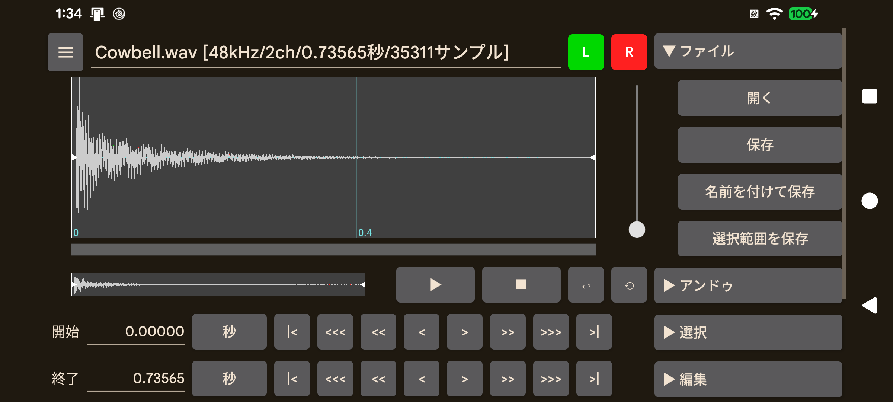

# mase - Mini Android Sound Editor 

[日本語](README.md) | English

<div align="center"></div>

## What is this?

mase is a simple sound editor for Android, focused on a single workflow: open one audio file, edit it, and export it.

- Open wav, mp3, and mp4 (audio track) files and edit selections directly on the waveform view.
- Edit selections with Trim, Cut, Copy, Paste, Insert, Append, Change volume, Normalize, Mute, Fade in/out, Invert phase, Reverse, Swap channels, and automatic silence/sound region selection.
- Mix, insert, or append sine waves, square waves, silence, or another audio file, and control L / R channels independently for display, playback, and processing on stereo audio.
- Process the entire audio with Change pitch (with optional WSOLA time-stretching), Change sample rate (5 resampling algorithms), Change playback rate, and Mono/Stereo conversion.
- Export edited audio as wav (8-bit / 16-bit), mp3 (via LAME), or m4a (AAC).
- Built purely with standard Android Views (no AndroidX dependencies), supporting Light/Dark mode, screen rotation (portrait/landscape), and English/Japanese UI.

## Requirements

- Android 14 (API 34) or later

## Usage

### Opening and saving files

1. Launch the app to open the editor screen. Under the **File** group, tap **Open** and choose an audio file (wav, mp3, or mp4).
   - If the input file has 3 or more channels, a dialog lets you pick up to 2 channels to load.
   - Audio is held in memory as 16-bit signed PCM (mono or stereo), up to under 10,000 seconds and under 1,000,000,000 samples.
2. When finished editing, export from the **File** group:
   - **Save**: Overwrites the previous destination with the same format settings (if **Save as** has already been used).
   - **Save as**: Choose format (wav, mp3, or m4a) and bit depth or bit rate to export the full audio.
   - **Save selection**: Exports only the region between the start and end positions.

### Waveform view and selection

- **Waveform display**: Mono is shown in white; stereo overlays L and R channels (L only in green, R only in red, overlap in white). You can also display only one channel using the **L** / **R** switches to the right of the file name. The selected region is highlighted with a gray background.
- **Zoom and scroll**:
  - Vertical zoom: slider bar on the right of the waveform view (1x to 256x)
  - Horizontal zoom: two-finger pinch, or double-tap and drag horizontally
  - Horizontal scroll: two-finger drag, or the scroll bar below the waveform view
  - Fit selection: double-tap the waveform view
- **Moving start and end positions**:
  - Drag the start/end bars in the waveform view or play view
  - Single-finger vertical swipe in the waveform view (top-to-bottom sets start position; bottom-to-top sets end position)
  - Use the position control rows below the play view for numeric input (seconds or samples) and step buttons (head/tail, 1 s, 0.1 s, 1 sample)

### Playback

- The play view below the waveform view always displays the entire audio along with the selection and current play position.
- Tap or drag on the play view to seek within the selected region.
- Use the buttons on the right to **Play (▶)**, **Stop (■)**, **Rewind (↩)**, and toggle **Repeat (⟲)**. During repeat playback, changes to the start/end positions take effect on the next loop. For stereo audio, the **L** / **R** switches toggle which channels are played in real time.

### Edit commands

Commands are organized into seven collapsible groups:

| Group | Commands | Description |
|---|---|---|
| **File** | Open / Save / Save as / Save selection | Load and export audio files |
| **Undo** | Undo / Redo | Undo and redo edits (max history configurable in Settings) |
| **Select** | Select silence / Select sound | Automatically select the silent or sound region around the start position |
| **Edit** | Trim / Cut / Copy / Paste / Insert / Append | Trim, delete, copy, overwrite, insert, or append audio regions |
| **Process selection** | Change volume / Normalize / Mute / Fade in / Fade out / Invert phase / Reverse / Swap channels | Adjust volume of the selection (dB input + slider), invert its polarity, reverse it in time, or swap L and R |
| **Process all** | Change pitch / Change sample rate / Change playback rate / Change channels | Transform pitch, sample/playback rate, or channels of the entire audio |
| **Add sound** | Mix sound / Insert / append sound | Mix a sine wave, square wave, or audio file into the selection, or insert silence, a sine wave, a square wave, or an audio file at the start position or at the end |

- For stereo audio, the **L** / **R** switches to the right of the file name choose which channels are shown in the waveform view, played back, and processed (processing applies to edits that keep the length and to silence/sound region selection; Swap channels always swaps both channels).
- Long-running edits and file loading run on background threads; operations taking more than 2 seconds display a progress dialog with a Cancel button.

### Settings and About

Open from the menu button (≡) at the top left:

- **Settings**: Customize waveform/play view colors (R/G/B/A color picker), silence detection duration (1–1000 ms) and threshold (-96 to 0 dB with presets), and max undo steps (0–99).
- **About mase**: View app version, copyright, app license (Apache License 2.0), and full license texts for included libraries (LAME 3.100).

## Building from source

Requirements (see [memo/doc/spec.md](memo/doc/spec.md) and [memo/doc/design.md](memo/doc/design.md) for Japanese specifications and design notes):

- JDK 17
- Android SDK (`ANDROID_HOME` environment variable; `compileSdk 36`)
- Android NDK `29.0.14033849` and CMake `3.22.1` (for building LAME)
- Internet access (first build only): the LAME 3.100 source package (`lame-3.100.tar.gz`) is downloaded from its distributor and placed in `third_party/`. Without internet access, place the same file in `third_party/` manually (see [NOTICE](NOTICE) for its SHA-256).

```sh
./gradlew assembleDebug
```

On Windows, run `gradlew.bat assembleDebug`. The debug APK is generated at `app/build/outputs/apk/debug/app-debug.apk`.

To build a release APK:

```sh
./gradlew assembleRelease
```

## Repository structure

| Path | Contents |
|---|---|
| `app/src/main/java/net/gorry/mase/` | App source code (Java / standard Android Views) |
| `app/src/main/cpp/` | Build configuration for LAME and JNI bridge for MP3 export (CMake). The LAME 3.100 source is not included; it is fetched at build time |
| `app/src/main/res/` | Layouts (portrait/landscape), light/dark mode colors, string resources (English/Japanese), vector icon |
| `app/build.gradle` | App Gradle configuration (reads `Profile.ini` and copies license files at build time) |
| `Profile.ini` | App title, version, copyright, and URL constants |
| `tools/make_icon.py` | Script to generate the app vector icon, SVG, and PNG |
| `pic/` | Standalone icon assets (SVG and 1024x1024 PNG) |
| `memo/doc/` | Design decisions (`design.md`) and specifications (`spec.md`) |
| `memo/log/` | Development logs (`YYYYMMDD.md`) |

## License & Copyright

Copyright (C) 2026 GORRY. \
This software is licensed under the Apache License 2.0 (see [LICENSE](LICENSE)). \
MP3 export uses [LAME](https://lame.sourceforge.io/) 3.100 (GNU Library General Public License Version 2) linked as a separate shared library (`libmp3lame.so`). See [NOTICE](NOTICE) for copyright and third-party library notices.

## Contact

- Project: https://github.com/gorry/mase
- Releases: https://github.com/gorry/mase/releases

## [EOF]
