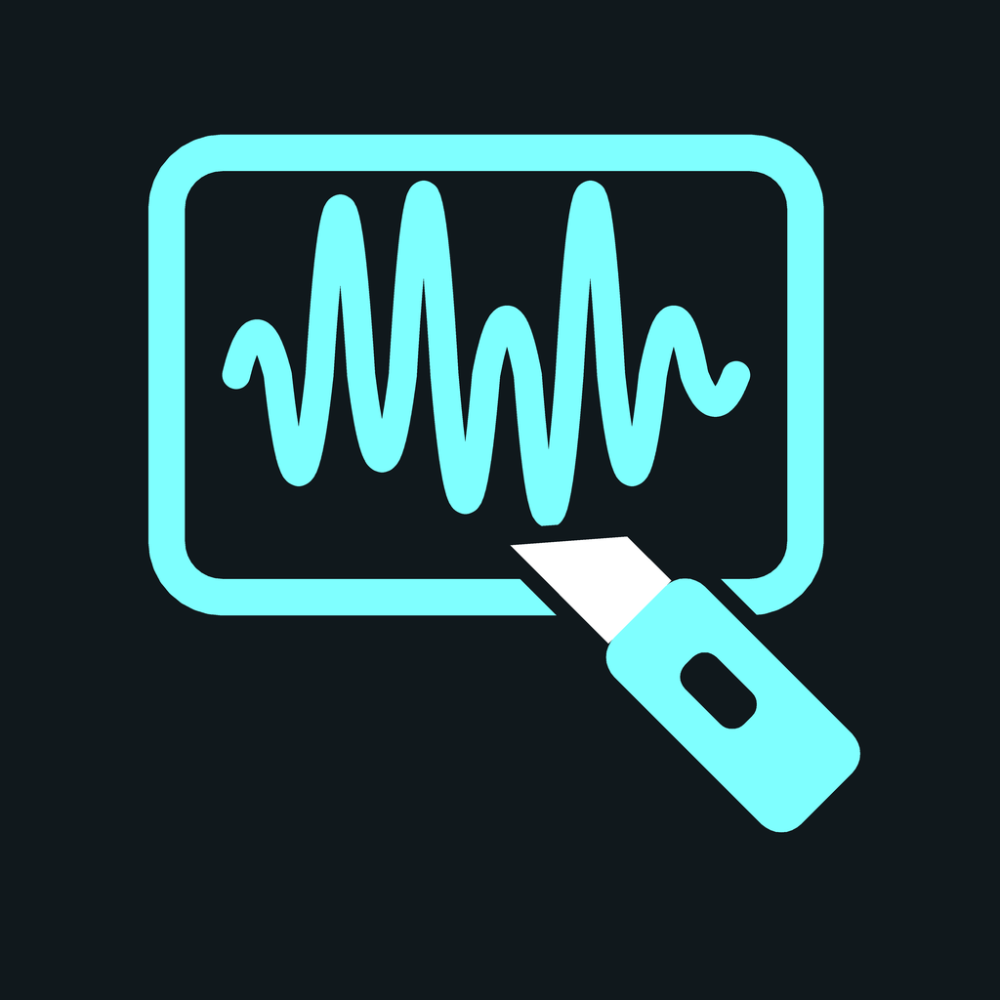
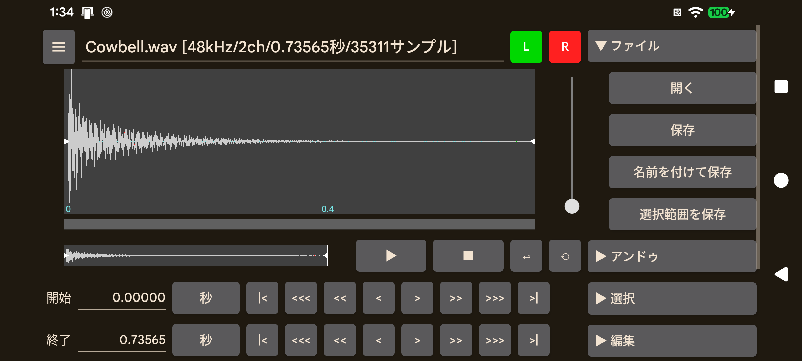

# mase - Mini Android Sound Editor 

日本語 | [English](README.en.md)

<div align="center"></div>


## これはなに？

mase は、Android 用のシンプルなサウンドエディタです。「1 つの音声ファイルを読み込み、編集して、書き出す」ことに機能を絞って作っています。

- wav・mp3・mp4（音声トラック）のファイルを読み込み、波形を見ながら範囲を選んで編集できます。
- 選択範囲のトリム・カット・コピー・貼り付け・挿入・末尾への追加、音量変更・最大化・無音化・フェードイン／フェードアウト・位相反転・逆再生・チャンネル入れ替え、無音区間・発音区間の自動選択ができます。
- サイン波・矩形波・無音・別音声ファイルのミックスや挿入・末尾追加、ステレオ音声の L / R チャンネル別の表示・再生・加工にも対応しています。
- 音声全体に対して、音程の変更（タイムストレッチ対応）、サンプリングレートの変更（5 種類のアルゴリズム）、再生レートの変更、モノラル／ステレオ変換ができます。
- 編集した音声は wav（8 / 16 bit）・mp3（LAME 使用）・m4a（AAC）形式で保存できます。
- Android 標準の View だけで構成しており、ライトモード・ダークモードおよび端末の回転（縦向き・横向き）に対応しています。表示言語は日本語と英語に対応しています。

## 必要なもの

- Android 14（API 34）以降

## 使い方

### ファイルを開く・保存する

1. アプリを起動すると編集画面が開きます。編集コマンドの「ファイル」グループから「開く」を押し、音声ファイル（wav・mp3・mp4）を選びます。
   - 3 チャンネル以上のファイルを開いたときは、読み込むチャンネルを 2 つまで選べます。
   - 内部の音声データは 16 bit PCM（モノラルまたはステレオ）で保持します。上限は 10,000 秒未満かつ 1,000,000,000 サンプル未満です。
2. 編集が終わったら、「ファイル」グループから書き出します。
   - **保存**：一度「名前を付けて保存」を実行済みなら、同じ保存先と設定で上書き保存します。
   - **名前を付けて保存**：形式（wav・mp3・m4a）と量子化ビット数またはビットレートを選んで、全体を保存します。
   - **選択範囲を保存**：開始位置から終了位置までだけをファイルに書き出します。

### 波形ビューと選択範囲の操作

- **波形の表示**：モノラルは白、ステレオは L と R を重ねて表示します（L のみ緑、R のみ赤、重なり白）。ファイル名右の **L** / **R** スイッチで片方のチャンネルだけを表示することもできます。選択範囲は背景がグレーになります。
- **拡大・スクロール**：
  - 縦の拡大：波形ビュー右側の倍率バー（1 倍～256 倍）
  - 横の拡大：指 2 本のピンチ操作、またはダブルタップ＆横スライド
  - 横のスクロール：指 2 本のスライド、または波形ビュー下のスクロールバー
  - 選択範囲に合わせる：波形ビューをダブルタップ
- **開始位置・終了位置の移動**：
  - 波形ビュー／再生ビュー上のバーをドラッグ
  - 波形ビュー上で指 1 本の縦スワイプ（上から下で開始位置、下から上で終了位置）
  - 再生ビューの下にある操作行で、数値入力（秒／サンプル切り替え）やステップ移動ボタン（先頭／末尾・1 秒・0.1 秒・1 サンプル）を使用

### 再生

- 波形ビューの下にある再生ビューには、音声データ全体と選択範囲・再生位置が表示されます。
- 再生ビューをタップまたはドラッグすると、選択範囲内でシークできます。
- 右端のボタンで **再生（▶）**・**停止（■）**・**巻き戻し（↩）**・**リピート（⟲）** を行えます。リピート中は次の繰り返しを始めるときに、動かした開始位置・終了位置を反映します。ステレオ音声では、**L** / **R** スイッチで再生するチャンネルをリアルタイムに切り替えられます。

### 編集コマンド

編集コマンドは折り畳みできる 7 つのグループに分かれています。

| グループ | コマンド | 内容 |
|---|---|---|
| **ファイル** | 開く / 保存 / 名前を付けて保存 / 選択範囲を保存 | 音声ファイルの読み込みと書き出し |
| **アンドゥ** | 元に戻す / やり直す | 編集の取り消しとやり直し（最大回数は設定で変更可能） |
| **選択** | 無音区間を選択 / 発音区間を選択 | 開始位置の前後の無音区間または発音区間を自動選択 |
| **編集** | トリム / カット / コピー / 貼り付け / 挿入 / 末尾に追加 | 選択範囲の切り出し・削除・複製・上書き・挿入・末尾への追加 |
| **選択範囲の加工** | 音量の変更 / 音量の最大化 / 無音化 / フェードイン / フェードアウト / 位相反転 / 逆再生 / チャンネル入れ替え | 選択範囲の音量調整（dB 指定＋スライダー）、位相反転、時間方向の反転、L と R の入れ替え |
| **全体の加工** | 音程の変更 / サンプリングレートの変更 / 再生レートの変更 / チャンネル数の変更 | 音声全体の音程・レート・チャンネル数の変換 |
| **音の追加** | 音のミックス / 音の挿入・追加 | サイン波・矩形波・音声ファイルを選択範囲にミックス、または無音・サイン波・矩形波・音声ファイルを開始位置に挿入・末尾に追加 |

- ステレオの音声では、ファイル名の右の **L** / **R** スイッチで、波形ビューの表示・再生出力・加工対象とするチャンネルを選べます（加工は長さが変わらない加工と無音区間・発音区間の選択に有効。チャンネル入れ替えは常時両チャンネルが対象）。
- 時間のかかる編集・読み込み処理はバックグラウンドで実行され、2 秒以上かかる場合は進捗とキャンセルボタンのダイアログが表示されます。

### 設定とアプリの情報

画面左上のメニューボタン（≡）から開けます。

- **設定**：波形ビュー・再生ビューの配色（R/G/B/A のカラーピッカー）、無音判定の期間（1～1000 ms）と音量しきい値（-96～0 dB・プリセット付き）、元に戻せる最大回数（0～99）を変更できます。
- **mase について**：バージョン、著作権表示、アプリのライセンス（Apache License 2.0）、および使用しているライブラリ（LAME 3.100）のライセンス全文を確認できます。

## 手元でビルドする（開発）

以下の環境が必要です。仕様は [memo/doc/spec.md](memo/doc/spec.md)、設計方針は [memo/doc/design.md](memo/doc/design.md) にあります。

- JDK 17
- Android SDK（環境変数 `ANDROID_HOME` で指定。compileSdk 36）
- Android NDK `29.0.14033849` / CMake `3.22.1`（MP3 書き出し用の LAME ビルドに使用）
- インターネット接続（初回のビルド時のみ）：LAME 3.100 のソースパッケージ（`lame-3.100.tar.gz`）を配布元からダウンロードし、`third_party/` に置きます。接続できない環境では、同じファイルを手で `third_party/` に置いてください（SHA-256 は [NOTICE](NOTICE) を参照）。

```sh
./gradlew assembleDebug
```

Windows の場合は `gradlew.bat assembleDebug` を実行します。ビルドが成功すると、`app/build/outputs/apk/debug/app-debug.apk` にデバッグ用 APK が作成されます。

リリース用 APK のビルド：

```sh
./gradlew assembleRelease
```

## 構成

| 場所 | 中身 |
|---|---|
| `app/src/main/java/net/gorry/mase/` | アプリ本体（Java / Android 標準 View） |
| `app/src/main/cpp/` | MP3 書き出し用の LAME のビルド設定と JNI ブリッジ（CMake）。LAME 3.100 のソースは含まず、ビルド時に取得します |
| `app/src/main/res/` | レイアウト（縦・横）、ライト／ダークモード配色、文字列リソース（英語・日本語）、ベクターアイコン |
| `app/build.gradle` | アプリのビルド設定（ビルド時に `Profile.ini` とライセンス文書を読み込む） |
| `Profile.ini` | アプリ名・バージョン・著作権表示などの定数定義 |
| `tools/make_icon.py` | アプリアイコンのベクター XML・SVG・PNG を生成するスクリプト |
| `pic/` | アプリ外で利用する画像（SVG・1024x1024 PNG・ドキュメント用画像など） |
| `memo/doc/` | 設計方針（`design.md`）・仕様書（`spec.md`） |
| `memo/log/` | 作業ログ（`YYYYMMDD.md`） |

## 著作権表記

Copyright (C) 2026 GORRY. \
本パッケージは Apache License 2.0（[LICENSE](LICENSE) ファイル）のもとで利用・改変・再配布できます。 \
MP3 の書き出しに [LAME](https://lame.sourceforge.io/) 3.100（GNU Library General Public License Version 2）を共有ライブラリ（`libmp3lame.so`）として使用しています。著作権と第三者ライブラリの表示は [NOTICE](NOTICE) ファイルを参照してください。

## 連絡先

- プロジェクト：https://github.com/gorry/mase
- リリース：https://github.com/gorry/mase/releases

## [EOF]
